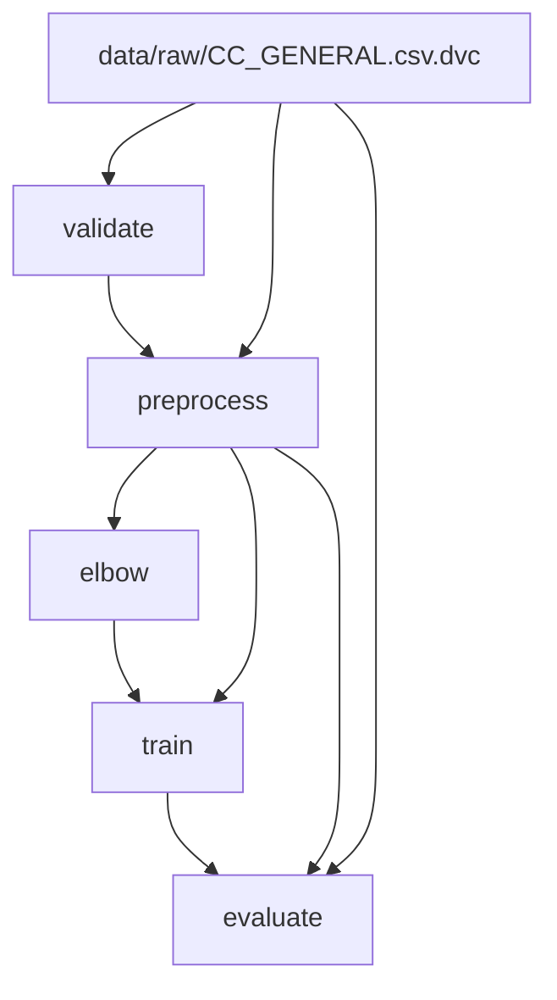

# DVC Lab 1: Versioned credit-card customer segmentation

Based on [MLOps / Labs / Data_Labs / DVC_Labs / Lab_1](https://github.com/raminmohammadi/MLOps/tree/main/Labs/Data_Labs/DVC_Labs/Lab_1).

The original lab tracks one text file (`data/data.txt`) in a Google Cloud Storage bucket. This version keeps every step of that lab and builds a full ML project around it:

- The Kaggle **CC GENERAL** dataset (8,950 credit-card customers × 18 columns) is versioned in **GCS** with DVC, as two dataset versions with a demonstrated rollback.
- A **5-stage DVC pipeline** validates the data, preprocesses it, finds *k* with the elbow method, trains a clustering model, and evaluates it, writing metrics, plots and segment profiles.
- **17 tracked experiments** (`dvc exp run`, `--queue`, grid sweeps) compare *k*, algorithm, scaling, log transform, clipping, imputation and data version. The best one is promoted to `main`.
- **Every command in the original README's command tables was run.** The results and full terminal logs are in [EXPERIMENTS.md](EXPERIMENTS.md) and [docs/logs/](docs/logs/).

## What changed from the original lab

| Area | Original | This version |
|---|---|---|
| Data | `data.txt` (28 bytes) | `CC_GENERAL.csv` (893 KB) with two tagged versions: `data-v1` (raw) and `data-v2` (cleaned) |
| Code | none | `src/` pipeline stages and `tests/` (8 unit tests) |
| Pipeline | none | `dvc.yaml` with 5 stages, `params.yaml`, metrics, 5 plots |
| Experiments | listed but not done | 17 experiments, compared with `exp show/diff` and `plots diff`, one promoted |
| `requirements.txt` | 200-line Airflow freeze | 8 pinned packages this lab actually imports |
| GCS credentials | key path committed in `.dvc/config`; service account given *Owner* | Application Default Credentials; optional key path stored only in `.dvc/config.local`; [script](scripts/setup_gcs_service_account.sh) grants `storage.objectAdmin` on this bucket only |
| `.gitignore` | `*.json` (would also hide metrics files) | ignores keys and `secrets/` but keeps `metrics/*.json` |

Fixes to typos in the original README:
- `dvc remote modify --lab2 credentialpath …` → `dvc remote modify lab2 credentialpath …`
- `git add data/CC_GENERAL_csv.dvc` → `git add data/CC_GENERAL.csv.dvc`
- `dvc init` creates a `.dvc/` **directory**, not "a `.dvc` file"

## Project layout

```
.
├── data/raw/CC_GENERAL.csv.dvc   # pointer to the dataset in GCS (the CSV itself is gitignored)
├── dvc.yaml / dvc.lock           # pipeline definition / exact hashes of every input and output
├── params.yaml                   # every tunable value; override with `dvc exp run -S`
├── src/
│   ├── validate.py               # schema, null, duplicate and range checks -> metrics/validation.json
│   ├── preprocess.py             # impute -> clip ratios -> winsorize -> log1p -> scale
│   ├── elbow.py                  # k sweep 2..12, knee found with `kneed` -> metrics/elbow.json, plots/elbow.csv
│   ├── train.py                  # kmeans | gmm | agglomerative; n_clusters can be "auto" (= knee)
│   └── evaluate.py               # silhouette / DB / CH (own and reference space), PCA plot, segment profiles
├── scripts/
│   ├── make_dataset_v2.py        # produces the cleaned v2 release
│   └── setup_gcs_service_account.sh
├── tests/test_pipeline.py
├── metrics/  plots/  reports/    # small outputs kept in git
├── models/  data/processed/      # large outputs stored in the DVC cache and GCS
└── docs/                         # experiment CSV, rendered plot reports, terminal logs
```

## Pipeline



## Quick start

```bash
python3.13 -m venv .venv && source .venv/bin/activate
pip install -r requirements.txt

gcloud auth application-default login     # or: scripts/setup_gcs_service_account.sh
dvc pull                                  # data, features and models from gs://dvc-lab1-cc-segmentation-shivam
dvc repro                                 # nothing to do: everything matches dvc.lock
dvc exp run -S train.n_clusters=5         # try a variation
dvc exp show
pytest -q
```

## Results

Promoted model (`model-v1` tag): **K-Means, k chosen automatically from the elbow knee (k=6)**, standard scaling with log1p and winsorizing, trained on dataset v2.

| Metric | Baseline (k=4) | Promoted (k=auto → 6) |
|---|---|---|
| Silhouette (reference space) ↑ | 0.2173 | 0.2182 |
| Davies-Bouldin ↓ | 1.687 | **1.465** |
| Smallest segment share | 17.6% | 11.3% |

The six segments ([reports/cluster_profiles.csv](reports/cluster_profiles.csv)):

| # | Customers | Profile |
|---|---|---|
| 5 | 1,456 | **Premium transactors**: highest purchases ($3.4k) and credit limit ($6.9k), buy often (0.92), 30% pay in full |
| 4 | 1,664 | **Instalment shoppers**: frequent (0.85) instalment buying, low balance, most likely to pay in full (33%) |
| 1 | 1,376 | **Occasional one-off buyers**: moderate balance, mostly one-off purchases, low frequency (0.33) |
| 0 | 1,242 | **Heavy revolvers**: high balance ($3.5k) from both purchases and cash advances, almost never pay in full |
| 3 | 2,195 | **Cash-advance users**: almost no purchases (~$16), $2.1k cash advances |
| 2 | 1,008 | **Dormant accounts**: balance ~$37, balance rarely updated (0.34) |

The most useful finding was about **evaluation**, not tuning. Silhouette computed in each experiment's own feature space made min-max scaling look best (0.279 vs 0.217). Scored in a fixed reference space it is actually *worse* (0.208). The evaluate stage now reports `*_ref` metrics so experiments can be compared fairly. See [EXPERIMENTS.md § 7](EXPERIMENTS.md#7-catching-a-misleading-metric).

## Command coverage

Every command in the original README's tables, and where it was run:

| Group | Commands | Log |
|---|---|---|
| Setup | `dvc init`, `dvc remote add -d`, `dvc config`, `dvc remote modify`* | [01](docs/logs/01_init.log), [03](docs/logs/03_remote.log), [21](docs/logs/21_destroy.log) |
| Tracking | `dvc add`, `dvc checkout`, `dvc status`, `dvc move`, `dvc remove` | [04](docs/logs/04_track_v1.log), [05](docs/logs/05_data_v2.log), [06](docs/logs/06_revert.log), [18](docs/logs/18_move.log), [19](docs/logs/19_remove_unprotect.log) |
| Storage | `dvc push`, `dvc pull`, `dvc fetch`, `dvc gc` (local and `--cloud`) | [04](docs/logs/04_track_v1.log), [15](docs/logs/15_collaborator.log), [16](docs/logs/16_fetch_checkout.log), [17](docs/logs/17_gc.log) |
| Pipelines and experiments | `dvc stage add`, `dvc dag`, `dvc repro`, `dvc exp run` (`-n`, `-S`, `--queue`, grid), `dvc queue`, `dvc exp show/diff/apply/remove/push/pull/list` | [07](docs/logs/07_pipeline.log)–[14](docs/logs/14_share.log) |
| Metrics, params, plots | `dvc metrics show/diff`, `dvc params diff`, `dvc plots show/diff` | [07](docs/logs/07_pipeline.log), [10](docs/logs/10_eval_fix.log), [12](docs/logs/12_compare.log), [20](docs/logs/20_debug.log), [22](docs/logs/22_plots.log) |
| Debugging | `dvc doctor`/`dvc version`, `dvc list` (local, git URL, GitHub), `dvc diff` | [20](docs/logs/20_debug.log) |
| Cleanup | `dvc destroy` (in a throwaway clone), `dvc unprotect`, `dvc cache dir` | [19](docs/logs/19_remove_unprotect.log), [21](docs/logs/21_destroy.log) |

\* `dvc remote modify … credentialpath` is in [scripts/setup_gcs_service_account.sh](scripts/setup_gcs_service_account.sh) and was not run; see [EXPERIMENTS.md § 2](EXPERIMENTS.md#2-gcs-remote).
